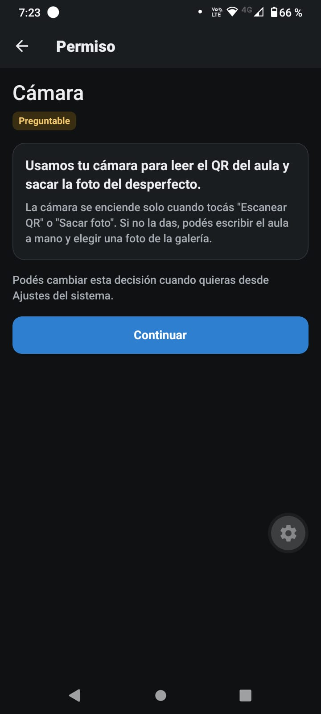
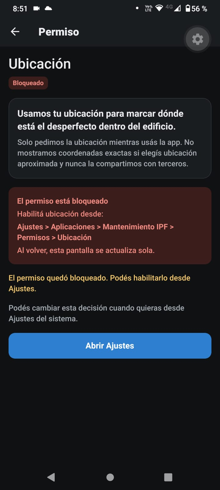
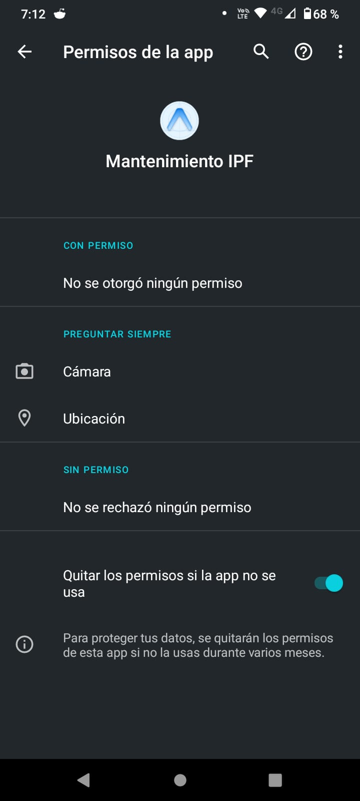
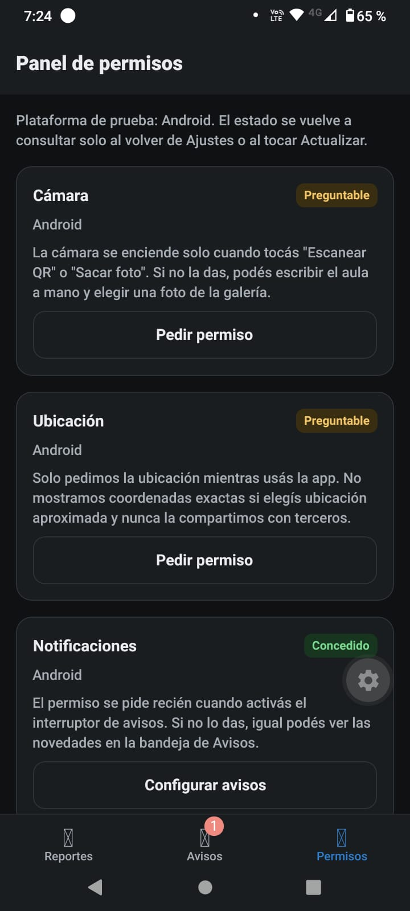
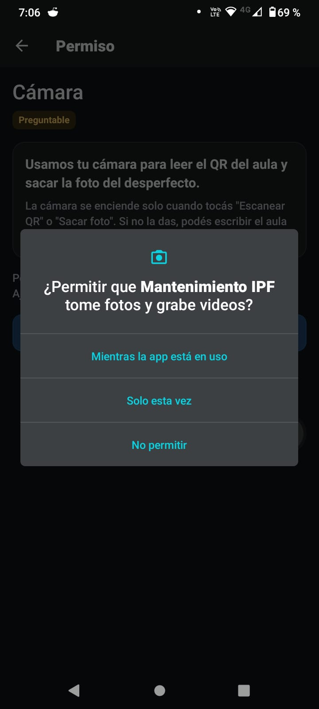

# Mantenimiento IPF — TP3

App móvil para que alumnos y docentes del Instituto Politécnico Formosa reporten
desperfectos del edificio (luces, canillas, mobiliario, equipos) y reciban un aviso
cuando se resuelven.

Trabajo Práctico N° 3 de **Taller Complementario – React Native II**.
Expo SDK 57 · React Native 0.86 · TypeScript · Expo Router · Android.

---

## Puesta en marcha

```bash
npm install
npx expo start
```

> **Windows / PowerShell**: si aparece el error “la ejecución de scripts está
> deshabilitada”, usá `npm.cmd` y `npx.cmd` (por ejemplo `npx.cmd expo start`), o
> habilitá scripts para tu usuario con
> `Set-ExecutionPolicy -Scope CurrentUser RemoteSigned`.

Escaneá el QR con **Expo Go** (Android). El teléfono y la PC tienen que estar en la
misma red; si el firewall bloquea la conexión usá `npx expo start --tunnel`.

> Expo SDK 57 requiere **Node.js 22.13 o superior**. Si la Expo Go instalada desde Play
> Store todavía no soporta SDK 57, descargá la versión compatible desde
> <https://expo.dev/go>, o directamente usá la development build (el repo ya incluye
> `eas.json` con el perfil `development`).

Verificación de tipos:

```bash
npm run typecheck   # npx tsc --noEmit
npx expo-doctor
```

> En Windows con la política de scripts bloqueada: `npm.cmd run typecheck` y
> `npx.cmd expo-doctor`.

> En Expo Go los textos de propósito, `blockedPermissions` y los plugins **no** se
> aplican: Expo Go tiene su propio manifiesto. Para ver la configuración real hay que
> instalar una development build (ver más abajo).

### Development build (EAS, sin Android Studio)

```bash
npx expo install expo-dev-client          # ya está instalado
npx eas-cli@latest login
npx eas-cli@latest init                   # crea el projectId en app.json
npx eas-cli@latest build -p android --profile development
```

El perfil `development` genera un APK que se instala desde el link de EAS. En esa
build sí aparecen los textos de propósito y se aplican los permisos bloqueados.
Para desarrollo local con Android Studio sería `npx expo run:android`.

---

## Árbol de rutas (`src/app`)

```
src/app/
├── _layout.tsx                 Stack raíz + providers + handler de notificaciones
├── (tabs)/
│   ├── _layout.tsx             Tabs: Reportes · Avisos · Permisos
│   ├── index.tsx               /                 lista de reportes propios
│   ├── avisos.tsx              /avisos           bandeja de avisos
│   └── permisos.tsx            /permisos         panel de estados
├── permisos/
│   └── [recurso].tsx           /permisos/camara|ubicacion|notificaciones|fotos
│                                                  (modal, pantalla previa)
├── reporte/
│   ├── nuevo.tsx               /reporte/nuevo
│   ├── escanear.tsx            /reporte/escanear
│   ├── foto.tsx                /reporte/foto
│   ├── ubicacion.tsx           /reporte/ubicacion
│   └── [id].tsx                /reporte/[id]
└── ajustes-app.tsx             /ajustes-app
```

Resto del código:

```
src/components/   boton, campo, tarjeta, badge-estado, estado-vacio, selector,
                  pantalla, resumen-ubicacion, themed-text, themed-view
src/hooks/        usePermiso.ts, useRevisarAlVolver.ts
src/lib/          permisos.ts, reportes.tsx, borrador.tsx, almacen.ts,
                  notificaciones.ts, tipos.ts
src/constants/    theme.ts
```

### URLs exigidas por la consigna

| URL | Pantalla |
| --- | --- |
| `/` | Inicio: reportes propios con estado + botón “Nuevo reporte” |
| `/reporte/nuevo` | Formulario con escanear, adjuntar foto y marcar ubicación |
| `/reporte/escanear` | Lector de QR con los cuatro estados |
| `/reporte/foto` | Sacar foto o elegir de la galería |
| `/reporte/ubicacion` | Ubicación actual + sector manual |
| `/reporte/[id]` | Detalle + “Simular resolución” |
| `/avisos` | Bandeja de avisos |
| `/permisos` | Panel de estados de permisos |
| `/permisos/[recurso]` | Pantalla previa (modal) |
| `/ajustes-app` | Interruptor de avisos |

---

## Flujo de permisos

El hook `src/hooks/usePermiso.ts` normaliza las respuestas de Expo a cuatro estados:
`cargando`, `concedido`, `preguntable` y `bloqueado`, más un indicador `parcial`
(ubicación aproximada o fotos limitadas) y `detalle` (`accuracy`, `accessPrivileges`,
notificaciones provisionales). Se actualiza al volver de Ajustes con `AppState`.

| Recurso | Módulo | Cuándo se pide | Si se deniega |
| --- | --- | --- | --- |
| Cámara | `expo-camera` | Al tocar “Escanear QR” o “Sacar foto” | Escribir el aula a mano / elegir de la galería |
| Ubicación (primer plano) | `expo-location` | Al tocar “Usar mi ubicación” | Elegir el sector a mano |
| Notificaciones | `expo-notifications` | Solo al activar el interruptor de `/ajustes-app` | Bandeja `/avisos` |
| Fotos | `expo-image-picker` | **Nunca**: selector del sistema para una sola foto | Elegir otra foto o continuar sin foto |

Reglas de diseño aplicadas:

- Antes de cada diálogo del sistema se muestra `/permisos/[recurso]` con el beneficio
  en una frase y **un único botón “Continuar”** (sin “Ahora no” ni “Cerrar”).
- Si el permiso está bloqueado, la pantalla explica la ruta exacta de Ajustes y el
  botón pasa a “Abrir Ajustes”.
- La app no insiste: no vuelve a mostrar la pantalla previa sola.
- Ningún permiso denegado impide cargar un reporte.
- En Android el canal `reportes` se crea **antes** de pedir notificaciones.

---

## `app.json` — bloque de plugins comentado

```jsonc
"plugins": [
  "expo-router",
  ["expo-splash-screen", { "backgroundColor": "#208AEF", "image": "./assets/images/splash-icon.png" }],

  // Cámara: solo QR y fotos. Sin micrófono ni RECORD_AUDIO.
  ["expo-camera", {
    "cameraPermission": "Usamos tu cámara para leer el QR del aula y sacar la foto del desperfecto.",
    "microphonePermission": false,
    "recordAudioAndroid": false,
    "barcodeScannerEnabled": true
  }],

  // Solo ubicación en primer plano (no se habilita background location).
  ["expo-location", {
    "locationWhenInUsePermission": "Usamos tu ubicación para marcar dónde está el desperfecto dentro del edificio."
  }],

  // Selector del sistema: no se pide permiso de galería. Micrófono bloqueado.
  ["expo-image-picker", {
    "photosPermission": "Usamos tus fotos para adjuntar la imagen del desperfecto al reporte.",
    "cameraPermission": "Usamos tu cámara para leer el QR del aula y sacar la foto del desperfecto.",
    "microphonePermission": false
  }],

  // Canal por defecto para las notificaciones locales.
  ["expo-notifications", { "defaultChannel": "reportes", "color": "#208AEF" }],

  "expo-sqlite"
]
```

`ios.infoPlist` repite los mismos textos en español para que no dependan del orden de
los plugins. Las claves son `NSCameraUsageDescription`,
`NSLocationWhenInUseUsageDescription` y `NSPhotoLibraryUsageDescription`.

### Permisos bloqueados

```jsonc
"android": {
  "blockedPermissions": [
    "android.permission.RECORD_AUDIO",              // no grabamos audio ni video con sonido
    "android.permission.READ_EXTERNAL_STORAGE",     // el selector del sistema no lo necesita
    "android.permission.WRITE_EXTERNAL_STORAGE",    // no escribimos en almacenamiento compartido
    "android.permission.READ_MEDIA_IMAGES",         // no leemos la galería completa
    "android.permission.READ_MEDIA_VIDEO",
    "android.permission.READ_MEDIA_AUDIO",
    "android.permission.SYSTEM_ALERT_WINDOW",       // no mostramos overlays
    "android.permission.ACCESS_BACKGROUND_LOCATION" // la ubicación es solo en primer plano
  ]
}
```

Motivos:

- **RECORD_AUDIO**: `expo-camera` e `expo-image-picker` lo agregan por defecto porque
  soportan video con audio. La app solo lee QR y saca fotos, así que se desactiva con
  `microphonePermission: false` y `recordAudioAndroid: false`, y además se bloquea.
- **READ/WRITE_EXTERNAL_STORAGE**: `expo-image-picker` los declara, pero
  `launchImageLibraryAsync` usa el selector del sistema (Photo Picker) y no necesita
  acceso amplio. En Android 13+ el reemplazo serían `READ_MEDIA_IMAGES` /
  `READ_MEDIA_VIDEO` / `READ_MEDIA_AUDIO`, que tampoco pedimos y además bloqueamos.
- **SYSTEM_ALERT_WINDOW**: no hay overlays; además es un permiso especial que Google
  Play cuestiona.
- **ACCESS_BACKGROUND_LOCATION**: solo usamos `requestForegroundPermissionsAsync`.
  Nunca se habilita `isAndroidBackgroundLocationEnabled`.

No se agrega `SCHEDULE_EXACT_ALARM`: la notificación de prueba es informativa y una
alarma inexacta alcanza. Pedirla sería privilegio innecesario.

---

## Funcionalidades y cómo probarlas

### 1. Reportes

- `/` arranca vacío. “Nuevo reporte” pide título, descripción, aula y categoría.
- Los reportes se guardan con `expo-sqlite/kv-store` (persisten al cerrar la app).
- `/reporte/[id]` valida el id: si no existe muestra “Reporte no encontrado”.
- En el detalle, “Eliminar reporte” pide confirmación y borra también sus avisos. En
  `/ajustes-app` está “Borrar todos los reportes” para limpiar la demo; además cancela
  las notificaciones pendientes.

Prueba: crear un reporte → volver → abrir el detalle → escribir una URL con un id
inventado (`/reporte/xxx`) → debe mostrar el mensaje.

### 2. Escáner QR (cuatro estados)

- **Cargando**: spinner mientras se consulta el permiso.
- **Concedido**: `CameraView` con `barcodeScannerSettings={{ barcodeTypes: ['qr'] }}`.
- **Preguntable**: explicación + “Continuar”.
- **Bloqueado**: aviso + “Abrir Ajustes”.

Siempre está disponible “Escribir el aula a mano”. El QR de prueba puede contener el
texto `Aula 12`; la app lo copia tal cual al campo Aula.

### 3. Foto

- “Sacar foto” abre `CameraView` y usa `takePictureAsync`.
- “Elegir de la galería” usa `ImagePicker.launchImageLibraryAsync` **sin** llamar a
  `requestMediaLibraryPermissionsAsync`.

Prueba: verificar que al elegir una foto **no** aparece ningún diálogo de permisos.

### 4. Ubicación

- Pide solo `requestForegroundPermissionsAsync`.
- Si el sistema da `accuracy: 'coarse'` (Android) o `'reduced'` (iOS), guarda
  `aproximada: true` y la UI muestra “Ubicación aproximada” sin coordenadas.
- Si se deniega, se elige un sector (Patio, Estacionamiento, Pasillo, Aula, Baño,
  Biblioteca) y el reporte se guarda igual.

### 5. Notificaciones y avisos

- El permiso se pide únicamente al activar el interruptor de `/ajustes-app`.
- Android: `setNotificationChannelAsync('reportes', …)` antes de pedir.
- “Simular resolución” en el detalle:
  - siempre agrega el aviso a `/avisos`;
  - si el permiso está concedido **y** el interruptor de `/ajustes-app` está activo,
    programa una notificación local a los 10 s con
    `SchedulableTriggerInputTypes.TIME_INTERVAL`.
- Si se deniega, el aviso queda en la bandeja y la app lo informa.

### 6. Volver de Ajustes

`useRevisarAlVolver` escucha `AppState` y `usePermiso` vuelve a consultar el estado al
pasar a `active`. El panel también se refresca al enfocar la pestaña.

Prueba: abrir `/permisos`, ir a Ajustes, cambiar un permiso, volver → el badge cambia
sin reiniciar la app.

### 7. Permisos “Solo esta vez” en Android

Android devuelve `canAskAgain: false` tanto para un permiso bloqueado como para uno
“Solo esta vez” que venció. Para no mostrar “Bloqueado” en el segundo caso, `usePermiso`
guarda un flag por recurso en `expo-sqlite/kv-store`:

- el flag se marca **solo** cuando un `request…()` real devuelve `denied` con
  `canAskAgain: false`;
- un `get…()` con `canAskAgain: false` y sin ese flag se muestra como **Preguntable**
  (“permiso temporal vencido: se puede volver a pedir”);
- cuando el permiso aparece concedido o “sin decidir”, el flag se limpia;
- en iOS se mantiene el comportamiento estricto: `denied` + `canAskAgain: false` es
  bloqueado.

Es una limitación conocida de Expo/Android (issues
[expo/expo#36883](https://github.com/expo/expo/issues/36883) y
[expo/expo#46683](https://github.com/expo/expo/issues/46683)).

---

## Auditoría del manifiesto (desafío opcional)

Ejecutado con:

```bash
npx expo prebuild --platform android --clean
```

En `android/app/src/main/AndroidManifest.xml` (manifiesto fuente) y en los manifests de
las librerías (`expo-camera`, `expo-image-picker`, `expo-location`, `expo-notifications`)
aparecieron estos permisos. La tabla combina ambos: los que dicen “manifiesto de
librería” se fusionan en la build y no se ven en el archivo fuente.

| Permiso | Quién lo agrega | ¿Queda? | Motivo |
| --- | --- | --- | --- |
| `INTERNET` | plantilla de Expo | Sí | Red de desarrollo; no accede a datos sensibles |
| `CAMERA` | `expo-camera` y `expo-image-picker` | Sí | Leer el QR y sacar la foto |
| `ACCESS_COARSE_LOCATION` | `expo-location` | Sí | Ubicación aproximada |
| `ACCESS_FINE_LOCATION` | `expo-location` | Sí | El sistema decide precisa/aproximada |
| `POST_NOTIFICATIONS` | `expo-notifications` (manifiesto de librería) | Sí | Aviso local de resolución; runtime en Android 13+ |
| `RECEIVE_BOOT_COMPLETED` | `expo-notifications` (manifiesto de librería) | Sí | Reprogramar notificaciones tras reiniciar; no accede a datos |
| `VIBRATE` | plantilla de Expo / `expo-notifications` | Sí | Vibración del canal de notificaciones |
| `READ_EXTERNAL_STORAGE` | `expo-image-picker` (`maxSdkVersion="32"`) | **No** (`tools:node="remove"`) | El selector del sistema no lo necesita |
| `WRITE_EXTERNAL_STORAGE` | `expo-image-picker` (`maxSdkVersion="32"`) | **No** | No escribimos en almacenamiento compartido |
| `READ_MEDIA_IMAGES` / `READ_MEDIA_VIDEO` / `READ_MEDIA_AUDIO` | ninguna librería; se bloquean de forma preventiva | **No** | No leemos la galería completa |
| `RECORD_AUDIO` | `expo-camera` / `expo-image-picker` si el micrófono está habilitado; acá está desactivado | **No** | No grabamos audio |
| `SYSTEM_ALERT_WINDOW` | plantilla de desarrollo (manifest `debug`) | **No** | No mostramos overlays |
| `ACCESS_BACKGROUND_LOCATION` | `expo-location` solo si se habilita background; acá no | **No** | Solo ubicación en primer plano |
| `SCHEDULE_EXACT_ALARM` | — | **No se declara** | No usamos alarmas exactas |

`POST_NOTIFICATIONS` y `RECEIVE_BOOT_COMPLETED` vienen del manifiesto de
`expo-notifications` y se fusionan en la build; no aparecen en el archivo fuente. No se
compiló el APK (no hay Android SDK en el equipo), así que la tabla es la unión de
manifiesto fuente + manifests de librerías, no el artifact final de Gradle.

`android/` se borró después de la auditoría: está gitignoreado y se regenera en cada
build (CNG).

---

## Capturas y video

Los archivos están en `docs/`.

### Capturas

| Archivo | Qué muestra |
| --- | --- |
| `01-pantalla-previa-camara.jpeg` | Pantalla previa de cámara en estado **Preguntable**, con la frase de propósito y “Continuar” |
| `02-pantalla-previa-ubicacion-bloqueada.jpeg` | Pantalla previa de **Ubicación bloqueada**, con la ruta exacta de Ajustes y “Abrir Ajustes” |
| `03-permisos-app-android.jpeg` | Ajustes de Android: solo Cámara y Ubicación; sin micrófono, galería ni almacenamiento |
| `04-panel-permisos.jpeg` | Panel `/permisos`: cámara y ubicación preguntables, notificaciones concedidas |
| `05-dialogo-sistema-camara.jpeg` | Diálogo nativo de Android pidiendo la cámara, sobre la pantalla previa |











### Video de la demo

[Ver video: demo-mantenimiento-ipf.mp4](docs/video/demo-mantenimiento-ipf.mp4)
(2:51 · 720×1600 · 36,4 MB)

El video recorre el flujo completo: alta de un reporte, escáner QR con sus estados,
foto desde el selector del sistema, ubicación concedida y denegada, notificación local
a los 10 segundos, bandeja de avisos y panel de permisos antes y después de volver de
Ajustes.

### Cobertura de la consigna G5

| Requisito | Evidencia |
| --- | --- |
| Escáner en sus cuatro estados | Video |
| Ubicación concedida y denegada | Video + captura 02 (bloqueada) |
| Foto desde el selector | Video |
| Notificación recibida | Video |
| Panel antes y después de Ajustes | Captura 04 (antes) + video |
| Diálogo del sistema en development build | Captura 05 |
| Mínimo privilegio | Captura 03 |

### Sobre el “texto de propósito” y Android (G5.4)

La consigna pide una captura del diálogo del sistema donde se vea el texto de propósito.
Eso **solo es posible en iOS**: Android arma el diálogo con texto genérico y no admite
una frase propia (es la respuesta B4.a del TP). En Android la frase se muestra en la
pantalla previa (captura 01) y el diálogo real queda documentado en la captura 05.

La frase está configurada para iOS en `app.json` (`cameraPermission`,
`photosPermission`, `locationWhenInUsePermission` y `ios.infoPlist` →
`NSCameraUsageDescription`, etc.) y en la UI en `src/lib/permisos.ts`. En una build de
iOS aparecería dentro del diálogo, debajo del título. Se priorizó Android por pedido de
la cátedra.

---

## Desafíos opcionales (G4)

- **Auditoría del manifiesto**: realizada; ver la tabla de la sección anterior.
- **Notificaciones provisionales (iOS)**: el pedido de `expo-notifications` incluye
  `allowProvisional: true`. Cuando iOS concede el modo provisional, `/permisos` y
  `/ajustes-app` muestran el badge **Provisional**, el matiz “Notificaciones
  provisionales” y una aclaración de que llegan en silencio. En Android la opción no
  tiene efecto.
- **Bloqueo por plataforma**: las pantallas de permiso bloqueado muestran la ruta
  exacta de Ajustes según `Platform.OS` mediante `rutaAjustes()` en
  `src/lib/permisos.ts`. Se usa en la pantalla previa, el escáner, la foto y la pantalla
  de avisos.
- **Nota de voz**: no implementada. Requiere `expo-audio`, desbloquear `RECORD_AUDIO` y
  una nueva build nativa; queda pendiente.

> La parte de notificaciones provisionales es específica de iOS y no se pudo probar en
> un dispositivo Apple: está validada por tipos y revisión de código.

---

## Decisiones y limitaciones

- **Sin backend**: los reportes viven en el dispositivo. No hay usuarios ni sincronización.
- **Fotos**: se guarda la URI local que devuelve la cámara (`cache`) o el selector. El
  sistema puede limpiar la caché; para la demo alcanza.
- **Notificaciones**: solo locales, no push. En Expo Go las locales funcionan en
  Android; el push remoto en Android requiere development build desde SDK 53.
- **Navegación**: se reemplazó `NativeTabs` del template por `Tabs` de Expo Router para
  tener un único layout, sin variantes web.
- **iOS**: la configuración está completa (textos de propósito, permisos), pero las
  pruebas se hicieron solo en Android, como pidió la cátedra.
- `expo-permissions` no se usa: está deprecado y cada módulo expone su propio permiso.

---

## Documentación de la entrega

- [`RESPUESTAS.md`](RESPUESTAS.md): respuestas de las Partes A–F.
- [`docs/`](docs): capturas y video de la demo.
